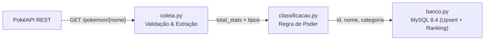

# ⚡ SistemaPython — Pipeline de Coleta PokéAPI & Persistência MySQL

[](https://www.python.org)
[](https://www.mysql.com)
[](https://docs.docker.com/compose/)
[](https://docs.pytest.org)

Pipeline em **Python** containerizado com **Docker Compose** que consome a **PokéAPI**, extrai e classifica atributos de Pokémon, persiste os registros de forma idempotente em **MySQL 8.4** e calcula o ranking médio de poder por tipo.

---

## 📌 Visão Geral & Funcionalidades

- **Coleta resiliente via HTTP (`app/coleta.py`)**: consulta o endpoint `https://pokeapi.co/api/v2/pokemon/{nome}` com *timeout* configurado e tratamento explícito de falhas (`PokemonNaoEncontrado` para HTTP 404 e `ErroDeApi` para erros de conexão, timeouts ou status inesperados).
- **Classificação por regra de negócio (`app/classificacao.py`)**: calcula o `total_stats` e classifica em `comum` (< 450), `forte` (450–599) ou `lendário` (≥ 600), validando entradas negativas.
- **Persistência transacional em MySQL (`app/banco.py`)**: cria as tabelas `pokemon` e `tipo_pokemon`, realiza *upsert* idempotente (`ON DUPLICATE KEY UPDATE` e `INSERT IGNORE`) com *rollback* em caso de erro e executa consulta analítica (`ranking_por_tipo`) com média de poder e contagem por tipo.
- **Testes automatizados com isolamento de rede (`tests/`)**: suíte em `pytest` + `pytest-mock` cobrindo sucesso, HTTP 404, HTTP 500, `ConnectionError`, `Timeout`, payload incompleto (`KeyError`) e regras de classificação.

---

## 🏛️ Arquitetura do Fluxo



---

## 📁 Estrutura do Repositório

```text
SistemaPython/
├── app/
│   ├── __init__.py
│   ├── main.py              # Ponto de entrada CLI (python -m app.main <pokemon>)
│   ├── coleta.py            # Cliente PokéAPI, exceções de domínio e extração de dados
│   ├── classificacao.py     # Regra de classificação por total de stats
│   └── banco.py             # Conexão MySQL, criação de tabelas, upsert e ranking SQL
├── tests/
│   ├── test_coleta.py       # Testes de API e resiliência (404, 500, timeout, conexão, payload)
│   └── test_classificacao.py # Testes unitários da regra de classificação
├── Dockerfile
├── docker-compose.yml       # Orquestração MySQL 8.4 (com healthcheck) + serviço app
├── requirements.txt
├── .dockerignore
└── .gitignore
```

---

## 🚀 Como Executar

### 1. Com Docker Compose (Recomendado)

1. Crie um arquivo `.env` na raiz do projeto com as credenciais do banco:

```env
MYSQL_ROOT_PASSWORD=sua_senha_root
MYSQL_USER=app
MYSQL_PASSWORD=sua_senha_app
```

2. Suba os containers (o serviço `app` aguarda o `healthcheck` do MySQL 8.4 e executa a coleta de exemplo para `pikachu`):

```bash
docker compose up --build
```

3. Para consultar outros Pokémon usando o container já construído:

```bash
docker compose run --rm app python -m app.main charizard
```

### 2. Execução Local (Python + MySQL)

```powershell
# Crie e ative o ambiente virtual
python -m venv .venv
.venv\Scripts\activate

# Instale as dependências
pip install -r requirements.txt
```

Configure as variáveis de ambiente de conexão (`DB_HOST`, `DB_PORT`, `DB_USER`, `DB_PASSWORD`, `DB_NAME`) e execute:

```powershell
python -m app.main mewtwo
```

---

## 🧪 Testes Automatizados

Os testes utilizam *mocks* HTTP (`pytest-mock`) para validar todos os cenários sem depender da API externa ou do banco em execução:

```bash
pytest -v
```
